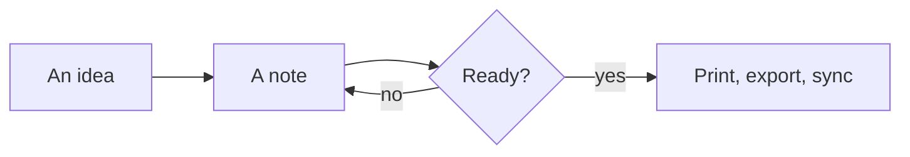
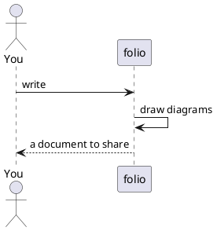

# Welcome to folio

folio reads, edits and prints Markdown — with diagrams, tables, boards, calendars
and API references drawn live — and works in projects of notes and of code.
**This page is read-only**: everything on it works the same in a note of your own.
Open it again any time from the commands: *What folio can do*.

> [!TIP]
> `⌘K` / `Ctrl+K` opens every command by name. `⌘N` starts a quick note (kept
> through restarts until you save it), `⌘O` opens a file, `⌘T` goes to a file
> of your projects by its name, `⌘,` opens the settings.

## Where your notes live

- **Shared** — one folder of your own, always there.
- **Projects** — any folders added with **+**: notes, or code (folio guesses which).
  The tree follows the disk; a project can keep a **git history** of its own.
- A file opened on its own works too — `.md`, diagrams, pictures, PDF, CSV, code.

## Writing

**Bold**, *italic*, ~~struck~~, ==highlighted==, `code`, [a link](https://example.com).
Switch between reading, the visual editor, the source and both side by side with
the mode button (`⌘E`).

- [x] Read the welcome page
- [ ] Write a note of my own 📅 2026-12-01
- [ ] Try the tasks panel — it gathers every `- [ ]` of the project by its date

| Feature | Where | Keys |
|---|---|---|
| Find in the document | any document | `⌘F` |
| Find in all files | every project | `⌘⇧F` |
| Go to a symbol | code | `⌘⇧O` |

> [!NOTE]
> Callouts: `> [!NOTE]`, `[!TIP]`, `[!IMPORTANT]`, `[!WARNING]`, `[!CAUTION]`.

## Links between notes

`[[Another note]]` links a note by its name (created when you follow it),
`[[Another note#A heading]]` a heading of it, `![[Another note]]` shows it inside
this one, `![[photo.png|300]]` a picture at a width. `#tags` and the `aliases:`
of a note's properties are found everywhere. The **Links** panel shows what links
here; the **Graph** shows it all.

## Formulas

The energy of a body at rest is $E = mc^2$; a sum of a series:

$$
\sum_{n=1}^{\infty} \frac{1}{n^2} = \frac{\pi^2}{6}
$$

## Diagrams

A diagram is a code block of its notation — Mermaid, PlantUML, Graphviz, D2,
DBML, Structurizr, Wardley maps; BPMN, DMN and draw.io too.





```dbml
Table notes {
  id int [pk]
  title varchar
  project_id int [ref: > projects.id]
}
Table projects {
  id int [pk]
  name varchar
}
```

## Boards and calendars

```kanban
## To do
- Try the diagrams
- Add a project
## Doing
- Read the welcome page
## Done
- Install folio
```

```calendar
date: 2026-11-01
2026-11-03 10:00 Review the notes
2026-11-12 14:00 Plan the quarter
2026-11-20 Release day
```

Files of their own — `*.kanban.md`, `*.calendar.md`, `*.board` (a whiteboard),
`.bpmn`, `.drawio`, `.mmd`… — open in their editors.

## API references

```openapi
openapi: 3.1.0
info: { title: Notes API, version: 1.0.0 }
paths:
  /notes:
    get:
      summary: List the notes
      responses: { "200": { description: The notes } }
```

## Code

```ts
// Highlighted in some 35 languages; in a project of code, edited
// in folio's own editor: completion, folding, many cursors.
export function greet(name: string): string {
  return `Hello, ${name}`
}
```

In a project of code folio runs its **tasks** (`⌘⇧B`) and lists their
**problems**, formats on save, talks to the **language servers** on your machine
(go to definition with `F12`, rename with `F2`, fixes with `⌘.`), and shows the
**changes** against git (`Ctrl+Shift+G`): stage, commit, stash, branches, sync.

## Files folio shows

Pictures (zoomed, fitted), video and sound in players, **PDF** in its viewer,
**CSV** as a table, **SVG** drawn and edited side by side, two files compared.

## Sharing

- **Print** (`⌘P`) and **PDF** (`⌘⇧P`): page size, margins, contents, page numbers.
- **Export as HTML** (one page) or **Word (DOCX)** from the commands.
- **Slides**: parts between `---` lines, shown with `F5`.

## Settings and languages

`⌘,` sets keys of your own for any command and a project's own settings.
The language follows the system, or is chosen in the settings menu; another
language is one JSON file in `folio-data/locales`.
