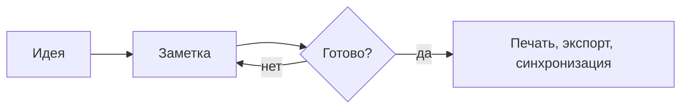
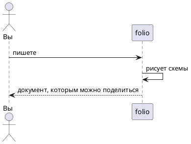

# Добро пожаловать в folio

folio читает, правит и печатает Markdown — со схемами, таблицами, досками,
календарями и справочниками API, нарисованными вживую, — и работает с проектами
заметок и кода. **Эта страница только для чтения**: всё на ней работает так же
в ваших собственных заметках. Открыть её снова можно командой
«Возможности folio».

> [!TIP]
> `⌘K` / `Ctrl+K` открывает любую команду по имени. `⌘N` — быстрая заметка
> (переживает перезапуск, пока вы её не сохраните), `⌘O` — открыть файл,
> `⌘T` — перейти к файлу проектов по имени, `⌘,` — настройки.

## Где живут заметки

- **Общие** — одна ваша папка, всегда под рукой.
- **Проекты** — любые папки, добавленные кнопкой **+**: заметок или кода (folio
  определяет сам). Дерево следует за диском; проект может вести свою **историю в git**.
- Отдельно открытый файл тоже работает — `.md`, схемы, картинки, PDF, CSV, код.

## Письмо

**Жирный**, *курсив*, ~~зачёркнутый~~, ==выделение==, `код`, [ссылка](https://example.com).
Чтение, визуальный редактор, исходник и оба рядом — кнопка режима (`⌘E`).

- [x] Прочитать приветствие
- [ ] Написать свою заметку 📅 2026-12-01
- [ ] Открыть панель задач — она собирает все `- [ ]` проекта по датам

| Возможность | Где | Клавиши |
|---|---|---|
| Поиск в документе | любой документ | `⌘F` |
| Поиск по всем файлам | все проекты | `⌘⇧F` |
| Переход к символу | код | `⌘⇧O` |

> [!NOTE]
> Выноски: `> [!NOTE]`, `[!TIP]`, `[!IMPORTANT]`, `[!WARNING]`, `[!CAUTION]`.

## Ссылки между заметками

`[[Другая заметка]]` ссылается на заметку по имени (создаётся при переходе),
`[[Другая заметка#Раздел]]` — на её раздел, `![[Другая заметка]]` показывает её
внутри этой, `![[фото.png|300]]` — картинку нужной ширины. `#теги` и `aliases:`
в свойствах заметки находятся везде. Панель **Ссылки** показывает, что ссылается
сюда; **Граф** — всё сразу.

## Формулы

Энергия покоящегося тела — $E = mc^2$; сумма ряда:

$$
\sum_{n=1}^{\infty} \frac{1}{n^2} = \frac{\pi^2}{6}
$$

## Схемы

Схема — это блок кода её нотации: Mermaid, PlantUML, Graphviz, D2, DBML,
Structurizr, карты Уордли; а также BPMN, DMN и draw.io.





```dbml
Table notes {
  id int [pk]
  title varchar
  project_id int [ref: > projects.id]
}
Table projects {
  id int [pk]
  name varchar
}
```

## Доски и календари

```kanban
## Сделать
- Попробовать схемы
- Добавить проект
## В работе
- Прочитать приветствие
## Готово
- Установить folio
```

```calendar
date: 2026-11-01
2026-11-03 10:00 Разобрать заметки
2026-11-12 14:00 План на квартал
2026-11-20 День выпуска
```

Отдельные файлы — `*.kanban.md`, `*.calendar.md`, `*.board` (доска),
`.bpmn`, `.drawio`, `.mmd`… — открываются в своих редакторах.

## Справочники API

```openapi
openapi: 3.1.0
info: { title: Notes API, version: 1.0.0 }
paths:
  /notes:
    get:
      summary: Список заметок
      responses: { "200": { description: Заметки } }
```

## Код

```ts
// Подсветка ~35 языков; в проекте кода — свой редактор folio:
// дополнение, сворачивание, несколько курсоров.
export function greet(name: string): string {
  return `Привет, ${name}`
}
```

В проекте кода folio запускает **задачи** (`⌘⇧B`) и показывает их **проблемы**,
форматирует при сохранении, работает с **языковыми серверами** на вашей машине
(определение — `F12`, переименование — `F2`, исправления — `⌘.`) и показывает
**изменения** в git (`Ctrl+Shift+G`): индекс, коммит, stash, ветки, синхронизация.

## Вкладки

Правый щелчок по вкладке показывает её файл в дереве (находит проект,
раскрывает папки), задаёт ей цвет, кладёт в группу (щелчок по названию группы
сворачивает её) и закрывает другие, те, что справа, сохранённые или все
(`⌘⇧W`); `⌘⇧T` возвращает последнюю закрытую. У вкладок консолей тоже есть
цвета и группы.

## Ревью работы агента

Работаете рядом с ИИ-агентом в терминале? **Ревью изменений** (`Ctrl+Shift+G`,
затем кнопка-страница) показывает их как пулл-реквест: просмотренные файлы
сворачиваются, фрагменты отправляются в индекс или откатываются, двойной щелчок
правит строку рядом. **С последнего просмотра** — только то, что агент сделал с
тех пор; **Worktree** (кнопка-ветка) — его worktree, чтобы отревьюить, забрать
или удалить; `+` у номера строки добавляет замечание, а **Отправить агенту**
вставляет их в его консоль.

## Какие файлы показывает folio

Картинки (масштаб, вписывание), видео и звук в плеерах, **PDF** в просмотрщике,
**CSV** таблицей, **SVG** — рисунком и правкой рядом, сравнение двух файлов.

## Поделиться

- **Печать** (`⌘P`) и **PDF** (`⌘⇧P`): формат, поля, оглавление, номера страниц.
- **Экспорт в HTML** (одна страница) или **Word (DOCX)** — из команд.
- **Слайды**: части между строками `---`, показ — `F5`.

## Настройки и языки

`⌘,` — свои клавиши для любой команды и собственные настройки проекта.
Язык — как в системе или выбранный в меню настроек; новый язык — один JSON-файл
в `folio-data/locales`.
